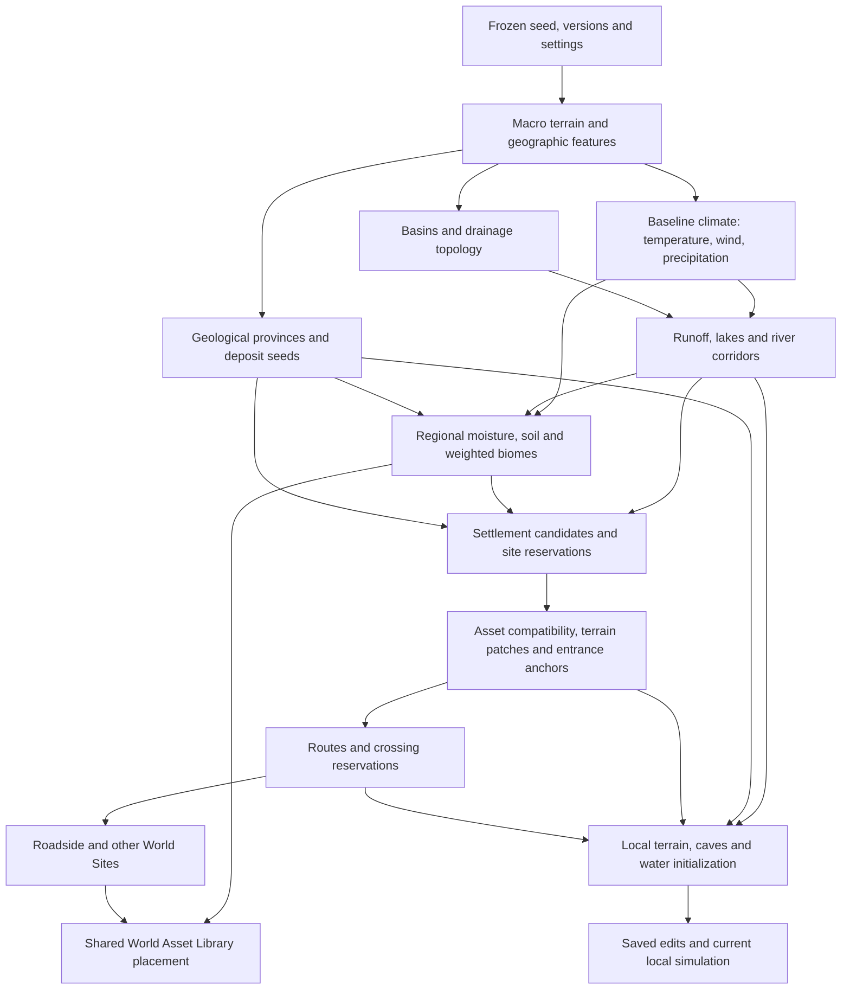

# Azgaar assessment for Thornwake

> 2026-09-29: `THORNWAKE_MASTER_REWORK_SUPPLEMENT_v1.md` supersedes conflicting policy below. In particular, ordinary lakes/ponds use finite storage, rivers/springs provide rate-limited inflow, and valid abstract downstream exports are distinct from arbitrary chunk-edge drains. See [the current drainage checkpoint](MASTER_DRAINAGE_CHECKPOINT.md) for inspected source state, validation and the exact next step. The older investigation/results below remain historical.

Reviewed 2026-09-28. C1 macro geography was finished and validated before this expanded assessment. This document is a proposal for incremental work, not an implementation claim. No Azgaar code, assets, tables or dependencies were imported. Existing gameplay, terrain, local water and saves were preserved.

## 1. Useful concepts, based on inspected source

| Reference | Observed mechanism | Thornwake adaptation |
| --- | --- | --- |
| [Generation pipeline](https://github.com/Azgaar/Fantasy-Map-Generator/blob/master/src/generators/generation-pipeline.ts) | Declared stages put height/features before temperature, precipitation, rivers, biomes, settlements and routes. | Explicit versioned dependencies and inspectable intermediate data. Preserve Thornwake's own ordering and terrain authority. |
| [Heightmap](https://github.com/Azgaar/Fantasy-Map-Generator/blob/master/src/generators/heightmap-generator.ts) | Composable hills, depressions, ranges, troughs, straits and smoothing. | Bounded owned landform descriptors in content profiles. Add basins/valleys to the existing sampler; do not replace its working continents and ranges. |
| [Temperature](https://github.com/Azgaar/Fantasy-Map-Generator/blob/master/src/generators/temperature-generator.ts) | Latitude and altitude influence temperature. | Pin latitude mapping and lapse settings in future climate configuration; world size alone must not determine the climate range. |
| [Precipitation](https://github.com/Azgaar/Fantasy-Map-Generator/blob/master/src/generators/precipitation-generator.ts) | Winds collect moisture over water and lose it over land/elevation barriers. | Coarse ocean-to-mountain moisture transport and rain shadows. Preserve reusable prevailing-wind data for eventual weather/sailing. |
| [Rivers](https://github.com/Azgaar/Fantasy-Map-Generator/blob/master/src/generators/river-generator.ts) | Downhill routing, depression handling, flux, tributaries and lake outlets. | Stable basin/river/lake metadata that initializes detailed local terrain and water. |
| [Biomes](https://github.com/Azgaar/Fantasy-Map-Generator/blob/master/src/generators/biomes-generator.ts) | Temperature/moisture classification with river and wetland effects. | Editable suitability curves producing blended biome weights; share environmental inputs with vegetation and terrain materials. |
| [Settlements](https://github.com/Azgaar/Fantasy-Map-Generator/blob/master/src/generators/burgs-generator.ts) | Suitability ranking, spatial spacing, water/port relationships and named metadata. | Reserve viable settlement sites before detailed assets exist; validate actual slope, water and footprint later. |
| [Routes](https://github.com/Azgaar/Fantasy-Map-Generator/blob/master/src/generators/routes-generator.ts) | Sparse settlement connections, weighted path search and reuse of existing connections. | Route corridors with travel costs, followed by local grade/crossing validation. Azgaar's elevation penalty is not a cart-safe slope constraint. |

These are design inferences from the linked implementations. References point to the inspected master branch and can change upstream.

## 2. Concepts not to adopt

Do not port its finite global graph as Thornwake's metre-scale world, compact cartographic heights as physical terrain, global mutable application state, or renderer-driven geometry as simulation authority. Its map boundaries must not become drains at render-chunk boundaries. Do not adopt political/cultural/economic generation merely to reproduce its pipeline. Avoid shared random sequences: an added naming or decoration pass must not move rivers.

A bounded coarse global graph may be useful metadata. It is not a replacement for streamed 3D chunks, stacked cave spaces, volumetric edits, collisions or persistent water storage. Biome lookup tables should not become abrupt material/vegetation borders. No wholesale import is proposed; any future source reuse must retain applicable [licence notices](https://github.com/Azgaar/Fantasy-Map-Generator/blob/master/LICENSE).

## 3. What Thornwake already handles differently

`MacroWorldManifest` freezes algorithm, seed, profile snapshot and digest. `MacroWorldGenerator` samples global double coordinates without constructing every chunk. `MacroRegionSampler` builds disposable local height/normal buffers; `WorldPoint` rebases before float conversion. `RegionStreaming.Plan` already accepts up to eight observer regions, with bounded loads and retention. The current engine streaming adapter remains tied to the legacy terrain; the new macro sampler is not yet a complete playable streamed world.

The cave lab already supports volumetric excavation, worker preparation, collision replacement and saved edits. `LocalWaterSimulation` stores finite volumes and stacked bed/roof intervals independently from its visual mesh. These are more relevant to mutable 3D gameplay than a cartographic river renderer, but remain bounded prototypes. Existing `SaveStore`, gameplay and content catalogues should be adapted, not discarded.

## 4. Small improvements now and the environmental layer

C1 already supplies useful immediate improvements: editable profiles, frozen manifests, independent sampling, a diagnostic preview and bounded chunk tests. Keep further changes at documented extension boundaries until their next milestone.

Add environmental data as versioned derived regional tiles associated with the same world manifest. Keep `MacroWorldManifest` a header/configuration snapshot; do not fill it with every environmental cell. Let a future composition query read the current macro elevation plus separately versioned climate, drainage and geology layers, and let `MacroRegionSampler` consume that query when those layers exist. This avoids a second competing terrain generator.

Each tile needs explicit units, cell size, bounds/halo, dependency digest and cache limits. Separate stable baseline climate/geology/watershed identity from mutable terrain, water and local drainage revisions. Current slope can be resampled locally after excavation without regenerating a continent's climate. Missing/unloaded data must be distinguishable from dry/empty values.

For the 2,048 km world, a 640-pixel preview has roughly 3.2 km samples. It is not authoritative environmental data. Evaluate a coarse global drainage skeleton plus regional refinement, with fixed budgets and cross-tile outlets; do not simulate every metre or allocate underground voxels globally.

## 5. Future work and immediate next gate

Next coherent milestone: a bounded drainage/basin spike over C1, proving spill levels, downstream continuity and river/lake descriptors. Compare priority-flood handling with a downhill graph. Keep flood-routing elevation separate from visible terrain; deliberate channel incision must enter the common terrain sampler. Use uniform runoff initially to test topology, then climate-derived runoff. Freeze drainage inputs/version before persistent worlds depend on it.

Before coupling those descriptors to local water, run the known ridge/ceiling regression in `MASTER_CONNECTED_WATER_RESULTS.md`. Inspection found fixed 0.5 m topology sampling versus selectable render spacing, plus midpoint-tested vertical connection bands. These are leads, not a proven cause. Verify transfer openings against the final terrain/collision surface at both resolutions; do not mask errors with shaders.

Production region transactions, water handoff, 3D macro adapters/LOD, climate/biome content, natural caves, spatial deposits and the shared World Asset Library remain subsequent gates. Settlements, route networks, NPC autonomy, traversal physics and full clock/material extensions are future work. This review does not implement them.

## 6. Proposed dependency pipeline

This is a dependency plan, not implementation order for every feature. Drainage topology can precede climate; final river flux consumes precipitation. Site patches require bounded drainage revalidation so they cannot dam a river silently. Do not regenerate the whole upstream pipeline each frame. Geology remains independent of biome; detailed veins/seams/pockets are queried regionally and exposed by intersection with current terrain/caves.

## 7. Settlements, roads, names and World Sites

A future `SettlementSite` should contain stable identity, world position, type, bounds, suitability constraints, water references, reserved entrance/spawn/NPC anchors, selected name and optional provider/asset reference. It exists while unloaded and before a town model is available. Authored and procedural providers can satisfy the same reservation; authored layouts are the initial preference.

Select sites using terrain/water/resources and spacing, assess regional accessibility, then choose a compatible authored footprint and expose entrance anchors before routing roads. Route search should account for grade, surface, wetlands, forest and explicit river crossings. Refine corridors to physical width/turning/grade requirements before carts rely on them. Preserve traversal costs separately from visual road textures. Place bridges, ruins and roadside scenes through the shared World Site/World Asset Library system and deterministic reservation rules, preventing overlaps.

Use editable regional naming sets and separate feature-specific random streams. Assign/persist names in canonical order, with a registry for settlement uniqueness; streaming order must not decide who receives a name. NPC name duplication needs a separate policy.

## 8. Blending authored settlement terrain

Store an asset-local terrain patch, fixed interior mask, feathered perimeter, permitted cut/fill range, drainage constraints, footprint and road endpoints. Transform it into world coordinates and validate against the base terrain before committing the reservation. Reject unsuitable sites rather than forcing a house onto a cliff.

A smooth weight can blend base height toward authored height at the perimeter. Apply the same patch to terrain sampling, collision, hydrology and vegetation exclusion across region borders. Near caves/overhangs, validate or use an explicit volumetric operation; a surface stamp must not accidentally fill a cave. Persist patch identity/version and resolve overlaps deterministically. Apply player deltas afterward so loading a settlement does not undo digging. Authored rivers, culverts and road grades must survive the blend.

## 9. Multiplayer, spawning and traversal

Extend the existing multi-observer planner, keeping shared regions deduplicated and adding measured priorities/budgets for terrain, physics, water and entities. The host owns world versions, edits and water transfers; clients receive relevant state. Unloaded regions retain metadata and saved deltas, not running local fluid/AI simulation. Never treat an unloaded neighbour as an open drain; define transactional exchange and load-order tests first.

Keep settlement/spawn metadata queryable without loading town geometry. The host should load and validate current terrain, water, obstacles and safe clearance before admitting a spawn; a historical anchor alone is insufficient after terraforming. Multiple players can choose the same settlement without needing all settlements active.

Keep future water queries independent of rendering: availability, body identity, surface level, bed/depth, immersion interval, shallow state and approximate flow. Current columns expose level/volume/bed/roof but do not yet provide a complete actor query or velocity field. Add those during local-water integration, including stacked caves and region origins. Preserve bays, landings, channels, inland lakes and wind fields as inputs for future swimming/sailing. Mounts, boats, carts and movement-mode controls are not part of C1.

## 10. Time, materials and principal risks

Time already has a useful base: `WorldState.Time`, `CalendarMinutes`, `Simulation.Tick` and `SandboxSettings.DayLengthMinutes` (2-180 minutes) are saved. A 120-minute day is representable. `Valley.Animate` currently assumes daylight from 06:00 to 18:00 and changes light intensity/colour; the sun angle is initially fixed. Eventually expose one authoritative clock facade over these existing values, configurable sunrise/sunset and continuous sun progression. Preserve the distinction between elapsed gameplay seconds and calendar time so crops, crafting and cooldowns do not silently change duration. Add host synchronization later, with explicit save migration; no new competing clock now.

Terrain materials should consume environmental weights plus current slope, depth and geology through reusable content-defined material sets. Blend borders and derive newly exposed rock from subsurface data. Share the World Asset Library among generation, biomes, sites and manual tools. Vegetation suitability can consume the same data while harvest identity stays species-based and physical size controls yield. Avoid a unique material per chunk and arbitrary material rules disconnected from biome generation.

| Risk | Required safeguard |
| --- | --- |
| Algorithm updates move existing terrain/features | Preserve algorithm-3 behaviour or introduce a new version; pin each future layer's inputs/content. Existing unsupported versions fail explicitly. Add fixed reconstruction fixtures before future algorithm changes. |
| Same seed diverges with load order/platform | Feature-scoped random streams, canonical ordering, deterministic IDs paired with world identity; cross-platform float equivalence remains unproven. Authoritative state resolves multiplayer disagreement. |
| Coarse drainage crosses rock or climbs at refinement | Shared terrain authority, explicit sill/ceiling validation, downhill/cross-border tests and geometry-aware refinement. |
| Large worlds exceed time/memory budgets | Bounded descriptors/tiles, multi-level addressing/LOD and local instantiation; the chunk unit test is not a production performance guarantee. |
| Generated water resets edited basins or duplicates volume | Initialize once, restore saved state, track finite storage/source policy and transactional regional transfers. |
| Sites overwrite terrain edits or alter rivers | Versioned patches, deterministic composition, drainage validation and persistent local deltas. |
| New layers invalidate legacy saves/gameplay | Additive labs and opt-in world versions; retain generators 1/2 and existing `SaveStore` until an explicit migration is tested. |

Current evidence and testing instructions are in `MASTER_MACRO_WORLD_FOUNDATION.md`, `VALIDATION.md` and `WORLD_GENERATION_TEST_GUIDE.md`. Completing C1 does not certify production multiplayer, unlimited worlds, generated natural caves or the remaining Master Rework.

